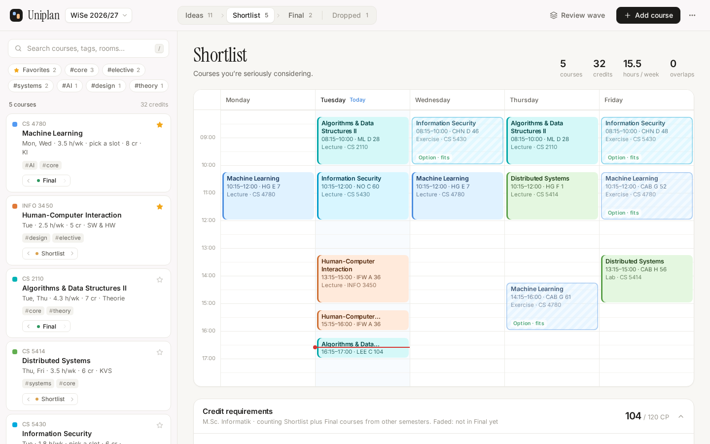
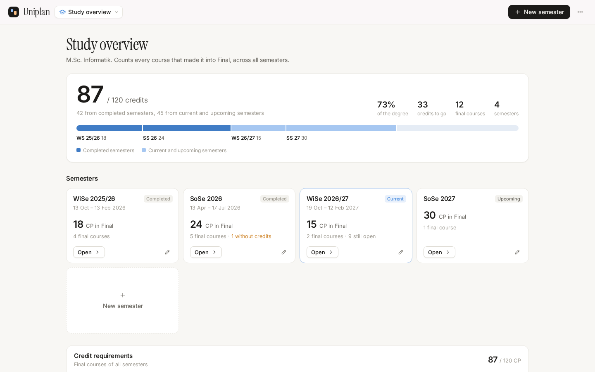
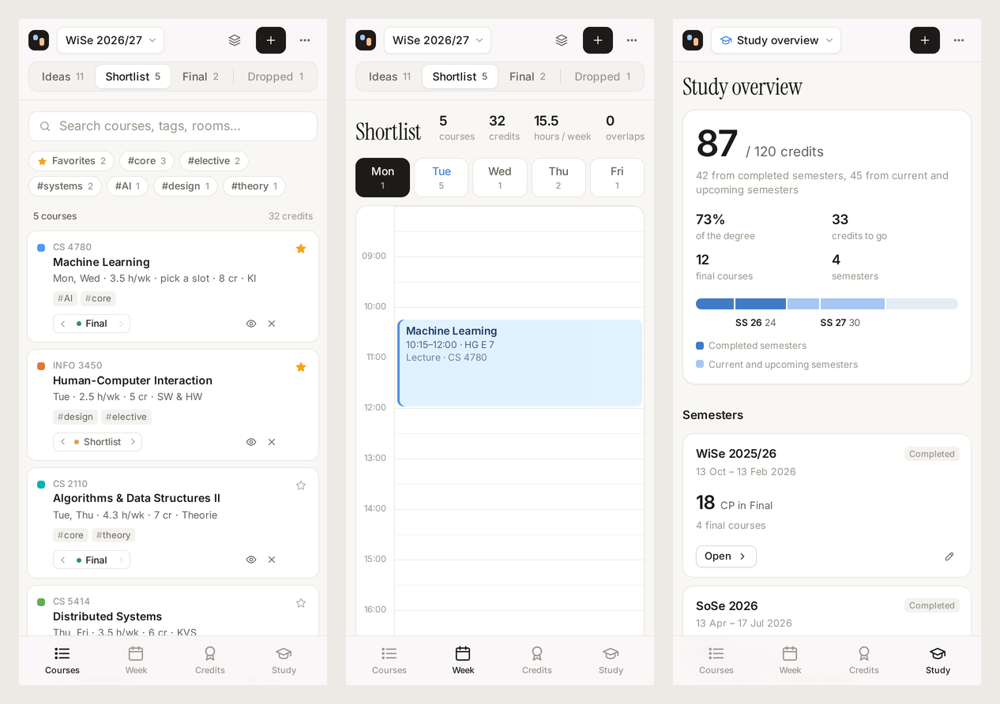

# Uniplan

Plan your uni semesters in waves, keep each semester's timetable and credits separate, and track how many credits your degree still needs.

Uniplan runs as a desktop app on macOS and Linux (Electron), as a phone app on iOS and Android (Capacitor), and in the browser. All of them use the same interface, and every app keeps its data on the device.







## Repository layout

```
packages/core   Data model and logic every app shares: semesters, overlaps, credit counting, calendar export, backups
apps/web        The interface (TypeScript and Vite, no framework). Runs in the browser and inside the other two apps
apps/desktop    Electron app for macOS and Linux
apps/mobile     Capacitor app for iOS and Android (the native Xcode and Android Studio projects live here)
e2e             Playwright tests for the web, phone and desktop apps
scripts         icons.py draws the app icons from the logo
```

This is an npm workspaces monorepo. You need Node 22.12 or newer (`.nvmrc` pins 24).

```sh
npm install
npm run dev            # web app on http://localhost:5173
npm run dev:desktop    # desktop app on the dev server, with hot reload
```

## Desktop app (macOS and Linux)

```sh
npm start              # build and open the desktop app
npm run dist:mac       # on a Mac: .dmg and .zip for Apple Silicon and Intel
npm run dist:linux     # AppImage and .deb
```

The builds land in `apps/desktop/release`. You can also get them without a local setup: run the **Release** workflow from the Actions tab and download the artifacts.

The Mac app is signed ad hoc, because there's no Apple developer certificate. A build you made on your own Mac opens normally. macOS blocks a downloaded one until you clear the quarantine flag:

```sh
xattr -dr com.apple.quarantine /Applications/Uniplan.app
```

Your data is one JSON file: `~/Library/Application Support/Uniplan/uniplan.json` on macOS, `~/.config/Uniplan/uniplan.json` on Linux. The app rewrites it on every change. Each write goes to a temporary file first and then replaces the old one, so a crash can't leave half a file. On start the app copies the file to `backups/` (one copy per day, the last 14 days). If the file can't be read, the app moves it aside instead of overwriting it. *⋯ → Show data folder* opens the folder.

## Phone app (iOS and Android)

```sh
npm run mobile:ios       # build, copy into the Xcode project, open Xcode
npm run mobile:android   # build, copy into the Android Studio project, open Android Studio
```

For iOS, open the App target in Xcode, choose your team under *Signing & Capabilities* and run it on your iPhone. A free Apple ID works; Apple then makes the app expire after 7 days, and you run it from Xcode again to renew it.

For Android, run it from Android Studio. You can also build an APK with `./gradlew assembleDebug` in `apps/mobile/android` (needs JDK 21 and the Android SDK) and install `app/build/outputs/apk/debug/app-debug.apk`. The Release workflow builds the same APK.

The phone app stores its data in the system's app preferences (UserDefaults on iOS, SharedPreferences on Android). Unlike browser storage, the OS doesn't clear those to free space. Export opens the share sheet, so you can save a backup to Files, AirDrop it or mail it.

## Moving data between devices

Each app keeps its own copy. To move it, use *⋯ → Export backup* on one device and *⋯ → Import backup* on the other. Import asks whether to merge or replace.

Backups from the old single-page version import too, into the open semester or a new one. If you open the new web version in the browser you used before, it picks up the old data by itself and puts it into a semester named after the current term.

## How it works

### Waves

1. **Ideas.** Brain-dump every course that sounds interesting (`N`, or *Save & add another*).
2. **Shortlist.** Move the good ones forward with the `›` arrow on a card, or press `R` to review the wave one course at a time (`←` drop, `↓` keep, `→` advance, `Backspace` back).
3. **Final.** Repeat until your final timetable has no red overlaps.

Each wave shows everything that got at least that far, so the timetable narrows as you go. Dropped courses stay in the **Dropped** tab, and you can restore them from there.

### Semesters

Every semester has its own courses, waves and timetable. Switch between them from the menu next to the logo (`S`), or step through them with `[` and `]`.

A new semester is named after the next term (WiSe 2026/27, SoSe 2027, and so on) unless you type something else. You can give it a lecture period. Uniplan uses the dates to order semesters, to mark them as completed, current or upcoming, and as the range of the calendar export. Without dates it reads the term from the name. You can also copy the open semester's Ideas and Shortlist into the new one.

To move a course to another semester, pick that semester in the course's editor.

In a semester, the credit requirements panel adds this semester's wave to the Final courses of all other semesters. The bars then show where your plan leaves the degree. A dashed chip per area sums up what the other semesters contribute.

### Study overview

Open it with `O`, the Study tab on the phone, or *Study overview* in the semester menu. It counts only courses in Final, across all semesters:

- total credits against the degree total, split into completed semesters and semesters still running or ahead
- a bar with one segment per semester
- one card per semester with its Final credits, dates and status
- the credit requirements, with each course labelled by its semester
- a table of every Final course, grouped by semester

### Degree requirements

*⋯ → Degree requirements* sets the degree's name, total credits, and the groups and areas the credits are counted in, each with a minimum and an optional maximum. It starts with the M.Sc. Informatik at TU Darmstadt. There are also presets for a 180-credit Bachelor and a 120-credit Master that only count the total. Renaming an area keeps its courses. If you remove one, its courses show up as not assigned.

### Other features

- Week timetable with overlapping sessions side by side and outlined in red
- Option slots: add several tutorial or exercise groups, tick *Option*, then click the one you want on the timetable. Each option shows whether it fits or clashes.
- Tags and a tag filter, favorites, an overlaps-only filter, and search across name, code, room and notes
- Hide a course from the timetable (eye icon) to try a plan without it
- Hover a card to highlight its sessions on the timetable, and the other way round
- Undo and redo for every change (`Ctrl/⌘ Z`, `Ctrl/⌘ Shift Z`)
- Calendar export (`.ics`) of a semester's Final courses, weekly over its lecture period (15 weeks from now if it has none)
- Print or save as PDF, light, dark and automatic theme
- On a phone: tabs for Courses, Week, Credits and Study, one day of the timetable at a time (tap a day or swipe), and full-screen editors

Shortcuts: `N` new course, `/` search, `R` review wave, `1` to `4` waves, `S` semesters, `[` `]` previous and next semester, `O` study overview.

## Development

```sh
npm run typecheck   # all packages
npm test            # unit tests for packages/core
npm run build       # web build in apps/web/dist
npm run e2e         # Playwright, against the web build
```

The desktop tests run when the desktop app is built (`npm run build -w @uniplan/desktop`). On Linux without a display, use `xvfb-run -a npm run e2e`.

CI runs the type checks, the unit tests, both builds and all end-to-end tests on every pull request. The Release workflow builds the macOS, Linux and Android apps. Pushing a tag such as `v2.0.0` also puts them on a draft GitHub release.

After changing the logo, run `python3 scripts/icons.py` (needs Pillow) to redraw the desktop icon and the iOS and Android icons and splash screens.
